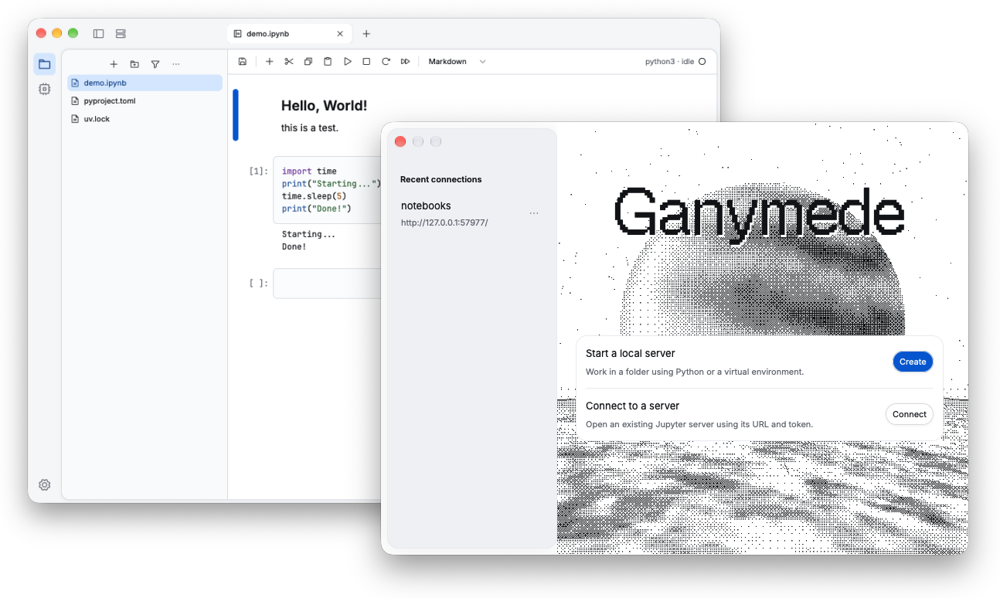

# Ganymede

A native Jupyter client (currently just) for macOS, written in Rust with GPUI.
Create or connect to a Jupyter server, edit notebooks, run cells, and manage files
and kernels in a desktop app.

## Install

Download the signed and notarized DMG from the
[latest GitHub release](https://github.com/a-poor/ganymede/releases/latest), open it,
and drag **Ganymede** into **Applications**. A ZIP is also available.

The current release requires **macOS 15 or later and Apple Silicon (M1 or newer)**.
Automatic updates are not implemented yet; download new versions from Releases.

## Get started

- **Create** starts a local server in your project folder using an existing Python
  environment. That environment needs `jupyter-server` and `ipykernel` installed.
- **Connect** opens an existing Jupyter server using its URL and optional token.
  SSH connections use your existing OpenSSH configuration and keys.
- Open or create a notebook, choose a kernel, and run a cell with **Shift+Enter**.

Python and Jupyter are not bundled. Closing a notebook or window leaves its kernels
running; server and kernel shutdown are explicit actions.

## Features

- Notebook editing and execution, Markdown, rich outputs, and cell undo/redo.
- File browsing and editing, uploads, renaming, moving, and deletion.
- Kernel management, connection status, and explicit reconnect controls.
- Autosave, unsaved-work recovery, recent connections, and restored workspace tabs.
- Light and dark themes, native menus, and persistent editor preferences.

Ganymede is early software. Jupyter widgets, real-time collaboration, password/cookie
login, and JupyterHub OAuth are not supported. Terminal, console, and Git features
are unfinished and excluded from release builds. Linux and Windows are also on the
roadmap.

## Documentation

- [User guide](docs/user-guide.md): connections, notebooks, files, recovery, and storage.
- [Contributing](CONTRIBUTING.md): build from source, checks, and development conventions.
- [Core API](docs/development/core-api.md): Rust clients and notebook controllers.
- [macOS distribution](docs/development/distribution.md): packaging, signing, and notarization.
- [Report a bug](https://github.com/a-poor/ganymede/issues).

*(Note: More and better documentation to come.)*

## License

Dual-licensed under either [MIT](LICENSE-MIT) or [Apache 2.0](LICENSE-APACHE). Dealer's choice.
Third-party dependencies and assets retain their own licenses; see
[third-party acknowledgments](THIRD_PARTY.md).
